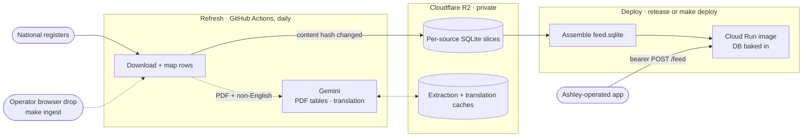

<div align="center">

# metal-birds-feed

[](https://github.com/anchildress1/metal-birds-feed/actions/workflows/ci.yml) [](LICENSE)

[](https://sonarcloud.io/project/overview?id=anchildress1_metal-birds-feed) [](https://sonarcloud.io/project/overview?id=anchildress1_metal-birds-feed) <!-- prettier-ignore-start --><!--START_SECTION:rai-badge--><!--END_SECTION:rai-badge--><!-- prettier-ignore-end -->


</div>

Maps national aviation registries into a normalized SQLite artifact in Cloudflare R2, and
serves fast tail-number and ICAO hex lookups from a private [feed service](#how-it-works) on
Cloud Run. Inspired by [metal-birds-watch](https://github.com/georgekobaidze/metal-birds-watch).

**Distribution model:** source-available code (Polyform Shield) + private operator artifacts.
Forks self-host against their own R2 bucket and their own per-source source-use assessment.
See [PRD.md](PRD.md) §Cross-Cutting for the full model.

## Contents

- [What you're getting into](#what-youre-getting-into)
- [Setting it up](#setting-it-up)
- [Working with AI agents](#working-with-ai-agents)
- [How it works](#how-it-works)
- [Tech stack](#tech-stack)
- [Project structure](#project-structure)
- [Commands](#commands)
- [Deploying your own copy](#deploying-your-own-copy)
- [Adding a registry source](#adding-a-registry-source)
- [Sources](#sources)
- [Attribution](#attribution)
- [Security](#security)
- [Legal Notice](#legal-notice)
- [Author](#author)
- [License](#license)

## What you're getting into

Before you copy it, three things decide whether you can:

- **The output is not yours to publish.** It goes to a private R2 bucket for Ashley-operated applications — no public read API, download, or query surface. Several registers granted access to Ashley by name, and some clearances are non-commercial. A fork owes its own per-source assessment before pulling anything — [DATA_LICENSES.md](DATA_LICENSES.md) records who said what.
- **It costs money.** Cloudflare R2 for the artifacts and Gemini for every PDF and non-English register, so a full refresh can't skip either. Cloud Run is optional, only if you serve the feed.
- **You are the operator.** Per-country data-use, storage, and privacy obligations land on whoever runs it. See [Legal Notice](#legal-notice).

> [!NOTE]
> R2 billing. The operator's first data load incurred approximately **$6.50 USD** in R2 charges.
> That is an observed bill, not a guaranteed quote or a claim about which billing dimension caused
> it. Check current R2 pricing and your account usage before pulling data.

> [!NOTE]
> Gemini billing. Every `format: pdf` source is read by Gemini, five pages per request. Roughly
> **$0.50–$1.30 USD per 100 pages** at November 2026 Gemini 3.8 Flash pricing, plus thinking tokens;
> check Google's current rate. A source's first extraction pays for every page; after that, only
> five-page chunks whose text changed are billed again. A dry run reads the stored extraction but
> never saves one, so it pays for every chunk not yet stored, every time.

## Setting it up

Two guides cover the whole path — accounts, credentials, first pull, local feed service — without assuming you read TypeScript:

- [docs/getting-started.md](docs/getting-started.md) — do it yourself, command by command
- [docs/getting-started-with-ai.md](docs/getting-started-with-ai.md) — have Claude Code or Codex drive it

The short version, once you have R2 credentials in `.env`:

```bash
make install                      # dependencies and git hooks
make refresh                      # pull every register (REFRESH_SOURCE=nl-ilt for just one)
make assemble-feed                # build feed.sqlite from the R2 slices
export FEED_TOKEN=$(uuidgen)      # required at startup, 16+ chars
make serve                        # serve it on :8080
```

## Working with AI agents

- [AGENTS.md](AGENTS.md) holds the rules every coding agent follows here: source posture, engine invariants, commit and branch conventions. `CLAUDE.md` just points at it.
- [`.agents/skills/setup-metal-birds-feed/`](.agents/skills/setup-metal-birds-feed/SKILL.md) is the setup skill behind [docs/getting-started-with-ai.md](docs/getting-started-with-ai.md). Codex reads it from `.agents/`; `.claude/skills/` holds a symlink so Claude Code finds the same file.

## How it works



A GitHub Actions matrix runs daily, one runner per `sources/*.yaml`. Each downloads the register's full export (registries publish no deltas), maps every row into the canonical `Aircraft` schema, hashes the result, and rewrites the per-source SQLite artifact in R2 only when that hash changed. `cadence_days` skips a source until it is due.

The feed service merges every source's slice into one `feed.sqlite`, baked into the Cloud Run image and opened read-only at startup — nothing is fetched at request time. Two endpoints, both bearer-gated, rate-limited, and batched to 500 keys:

- **`POST /feed`** `{"hexes": ["a1b2c3"]}` → descriptive rows keyed by ICAO hex
- **`POST /feed/registration`** `{"registrations": ["C-FABC"]}` → the same rows keyed by registration, plus `icao_hex`

Both keys exist because a register does not have to publish a hex; registration is always present. Every row carries the upstream `attribution` string to display with it. Misses are omitted rather than returned null.

```bash
curl -s http://localhost:8080/feed \
  -H "Authorization: Bearer $FEED_TOKEN" \
  -H "Content-Type: application/json" \
  -d '{"hexes": ["a1b2c3", "d4e5f6"]}'
```

Deeper mechanics — R2 key layout, version markers, duplicate resolution, the deploy path — live in [AGENTS.md](AGENTS.md), which is authoritative.

## Tech stack

| Layer      | Choice                                                                    |
| ---------- | ------------------------------------------------------------------------- |
| Runtime    | Bun, TypeScript (ESM)                                                     |
| Storage    | SQLite (`bun:sqlite`); Cloudflare R2 over the S3 API                      |
| AI         | Google Gemini via `@google/genai`: PDF table extraction, translation      |
| Parsing    | `csv-parse`, SheetJS `xlsx`, `unpdf` + `pdf-lib` (PDF text layer, chunks) |
| Validation | `zod`                                                                     |
| Serving    | Cloud Run, `oven/bun` image                                               |
| CI/CD      | GitHub Actions, Release Please, SonarCloud, CodeQL, Semgrep               |

## Project structure

```text
src/            pipeline: download, map, history, write
  pdf/          Gemini reads PDF register tables, five pages per call
  localize/     Gemini translation and its cache
  service/      the feed service Cloud Run serves
sources/        one YAML config per register
fixtures/       real upstream rows per source; CI ground truth
tests/          mirrors src/
docs/           setup guides, onboarding checklist, permission-request template
.agents/skills/ the AI setup skill
```

## Commands

| Command                  | Description                                                                                            |
| ------------------------ | ------------------------------------------------------------------------------------------------------ |
| `make install`           | Install dependencies and git hooks                                                                     |
| `make check`             | format-check + lint + typecheck + test (CI gate)                                                       |
| `make refresh`           | Update R2: pull every source, or one with `REFRESH_SOURCE=<id>` (reads `.env`; the command line wins)  |
| `make ingest`            | Store a browser-downloaded file for a `manual` source and refresh it (`SOURCE=<id> FILE=drops/<file>`) |
| `make record-extraction` | Re-record Gemini's response for a PDF source's fixtures (`SOURCE=<id>`; billed)                        |
| `make assemble-feed`     | Build `feed.sqlite` from the R2 slices (no refresh)                                                    |
| `make serve`             | Run the feed service locally (`MBF_FEED_DB_PATH`)                                                      |
| `make deploy`            | Assemble `feed.sqlite` from R2 and deploy it to Cloud Run (does not refresh)                           |
| `make secret-scan`       | Scan for accidentally committed secrets                                                                |

`make help` is the default target and lists these plus `clean`. The steps `check` and `deploy` chain (`format-check`, `lint`, `typecheck`, `test`, `build`, `deploy-only`) also run on their own, as does `format`.

## Deploying your own copy

Required GitHub Actions secrets: `MBF_R2_ACCOUNT_ID`, `MBF_R2_ACCESS_KEY_ID`, `MBF_R2_SECRET_ACCESS_KEY`, `MBF_R2_BUCKET_NAME`, `GEMINI_API_KEY`, `SONAR_TOKEN`.

Required variables: `GCP_PROJECT_ID`, `GCP_WORKLOAD_IDENTITY_PROVIDER`, `GCP_SERVICE_ACCOUNT`, plus optional `GEMINI_REQUESTS_PER_MINUTE` (default 10), `GCP_RUN_REGION` (default `us-east1`), `GCP_RUN_SERVICE` (default `metal-birds-feed`).

`FEED_TOKEN` is a Google Secret Manager binding on the Cloud Run service — never copied into GitHub or `.env`.

## Adding a registry source

[AGENTS.md](AGENTS.md) is authoritative: source-use posture first, then all six surfaces (config, fixtures, `DATA_LICENSES.md`, the sources table below, `src/service/attributions.ts`, the onboarding checklist). Miss one and the source is incomplete. [docs/source-onboarding-checklist.md](docs/source-onboarding-checklist.md) tracks what is still in triage.

## Sources

Sources active in the private operator pipeline, ordered alphabetically by country. ID is
the `sources/<id>.yaml` config stem. Sources that are cleared but not yet contributing rows
— and every source still in triage — are tracked in
[DATA_LICENSES.md](DATA_LICENSES.md) and
[docs/source-onboarding-checklist.md](docs/source-onboarding-checklist.md), not here.

<!-- prettier-ignore-start -->
| ID | Agency | Country | Status |
| --- | --- | --- | --- |
| `au-casa` | CASA | Australia | ✅ Live |
| `br-anac` | ANAC Brasil | Brazil | ✅ Live |
| `tc-ca` | Transport Canada | Canada | ✅ Live |
| `cl-dgac` | DGAC | Chile | ✅ Live |
| `hr-ccaa` | CCAA | Croatia | ✅ Live |
| `ee-tram` | Transpordiamet | Estonia | ✅ Live |
| `fj-caaf` | CAAF | Fiji | ✅ Live |
| `hu-kh` | Közlekedési Hatóság | Hungary | ✅ Live |
| `jm-jcaa` | JCAA | Jamaica | ✅ Live |
| `lv-caa` | CAA Latvia | Latvia | ✅ Live |
| `lt-tka` | TKA | Lithuania | ⏸️ Paused — VPN-only upstream, manual refresh; last slice still served |
| `mv-caa` | CAA Maldives | Maldives | ✅ Live |
| `nl-ilt` | ILT | Netherlands | ✅ Live |
| `nz-caa` | CAA NZ | New Zealand | ✅ Live |
| `no-caa` | Luftfartstilsynet | Norway | ✅ Live |
| `sg-caas` | CAAS | Singapore | ✅ Live |
| `es-aesa` | AESA | Spain | ✅ Live |
| `ch-foca` | FOCA / BAZL | Switzerland | ✅ Live |
| `tw-caa` | CAA Taiwan | Taiwan | ✅ Live |
| `th-caat` | CAAT | Thailand | ✅ Live — manual browser drop (`make ingest`) |
| `faa` | FAA | United States | ✅ Live |
<!-- prettier-ignore-end -->

Full correspondence/status detail: [DATA_LICENSES.md](DATA_LICENSES.md).

---

## Attribution

Every aircraft record the feed service hands out comes with a credit line for the authority that published it, so whatever displays the aircraft displays the credit too.

Reading the SQLite artifacts out of R2 directly does not go through that service, and those rows carry only a source ID. On that path, attaching the right credit is your job — `src/service/attributions.ts` holds the exact string for each source.

Several authorities set conditions on that credit: exact wording they require, or limits on what the data may be used for. All of it is written down in [DATA_LICENSES.md](DATA_LICENSES.md) — who was asked, what they said, what each source requires, and which sources are non-commercial only.

If you fork this, those conditions are yours to meet. Read that file before you pull anything.

---

## Security

- **Feed access:** both endpoints need `FEED_TOKEN` as a bearer token, are rate-limited, and answer exact key lookups only. There is no list, filter, or bulk download.
- **Secrets:** `.env` locally, GitHub Actions secrets in CI, Google Secret Manager for `FEED_TOKEN`. Nothing is committed; `make secret-scan` checks.
- **Personal data:** owner and operator keep only name, kind, state, and country. Addresses are dropped at mapping.
- **Gemini sees full pages:** PDF pages go to Google's paid Gemini API, owner names and addresses included. [DATA_LICENSES.md](DATA_LICENSES.md) records that exposure per source.

---

## Legal Notice

- **No liability transfer.** Using, forking, or deploying this repository does not transfer liability to the maintainer. Each operator is solely responsible for their own deployment and its consequences.
- **Private output only.** The maintained deployment writes normalized artifacts only to Ashley's private R2 bucket for Ashley-operated applications. It does not publish a public API, public dataset, or public download.
- **Per-country compliance is the operator's responsibility.** This project ingests data from civil aviation authorities in multiple jurisdictions. Each imposes its own data-use, storage, caching, redistribution, and privacy obligations. Operators must independently assess and satisfy those obligations.
- **Research is informational, not legal advice.** The source-use classifications and permissions in `DATA_LICENSES.md` reflect good-faith research at a point in time. They are not legal advice and carry no guarantee of completeness, accuracy, or continued validity.
- **Upstream terms change without notice.** Agencies amend terms, withdraw permissions, or restructure publication channels. Operators are responsible for monitoring those changes.
- **No liability.** The data pipeline, its output, and the license research are provided as-is. See the `No Liability` section of the [LICENSE](LICENSE).

## Author

**Ashley Childress**

[](https://dev.to/anchildress1) [](https://www.linkedin.com/in/anchildress1/) [](https://x.com/anchildress1) [](https://www.buymeacoffee.com/anchildress1)

---

## License

[Polyform Shield 1.0.0 + Supplemental Terms](LICENSE)

Source-available, not open source. GitHub hosting doesn't make it MIT.

- **You can** use, fork, and adapt it for your own work, inside your company, on client projects, or for teaching.
- **You can't** sell it, host it as a paid service, build a competing product on it, or otherwise make money from the project itself without written permission.
- **Public forks** keep the LICENSE file and credit: "Based on original work by Ashley Childress — see https://github.com/anchildress1/metal-birds-feed."
- **Upstream data terms** are yours to meet, register by register. The license covers the code, not the data.
